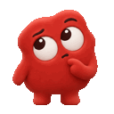
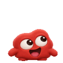
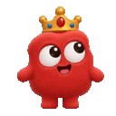
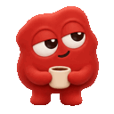
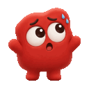
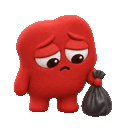
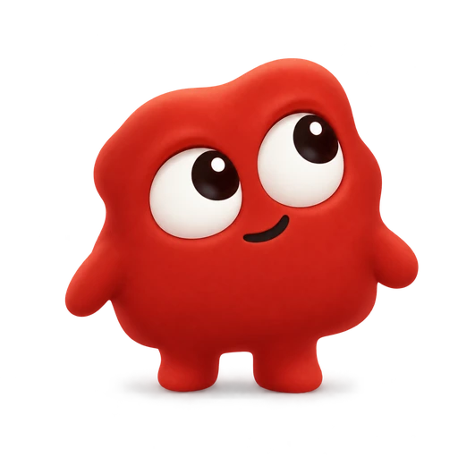
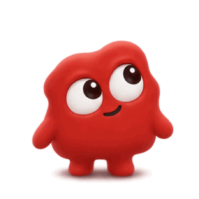

# Nudgy Slack görselleri / Slack assets

Profil görselini, emojiyi ve GIF'i buradan ayrı ayrı indirebilirsin. GitHub'da
dosyayı açıp **Download raw file** seçeneğini kullan; projeyi klonladıysan
dosyalar zaten bu klasörde bulunur.

| Dosya | İçerik | Kullanım |
| --- | --- | --- |
| [nudgy-icon.png](nudgy-icon.png) | 512 × 512 PNG | Slack uygulama/profil görseli |
| [nudgy-profile.png](nudgy-profile.png) | 1024 × 1024 PNG | Açık arka planlı orijinal profil görseli |
| [nudgy-thinking-emoji.png](nudgy-thinking-emoji.png) | 128 × 128 PNG | `:nudgy-thinking-emoji:` özel emojisi |
| [nudgy-kalpler.gif](nudgy-kalpler.gif) | 400 × 400, 16 kare, döngülü GIF | Mesaja dosya olarak eklenebilir |

### Hareketli emojiler

Bu yedi GIF'in her biri 128 × 128 piksel, 6–9 kare ve 44 KB altındadır.
Emoji menüsünden ayrı ayrı yüklenebilirler.

| Önizleme / indir | Önerilen emoji adı |
| --- | --- |
|  | `nudgy-thinking-emoji` veya `nudgy-dusunme` |
|  | `nudgy-zipla` |
|  | `nudgy-kral-dans` |
|  | `nudgy-kahve` |
|  | `nudgy-panik` |
|  | `nudgy-paydos` |
|  | `nudgy-uzgun` |

### Mesajlar için büyük GIF'ler

512 × 512 piksel sürümleri dosya olarak paylaşmak için kullan:
[Kahve](nudgy-kahve-message.gif), [Panik](nudgy-panik-message.gif),
[Paydos](nudgy-paydos-message.gif). Bunlar özel emoji için hazırlanan küçük
sürümlerden ayrıdır. Kalpli GIF ile birlikte pakette toplam 11 GIF vardır.

## Slack'e ekleme

1. **Uygulama görseli:** Kendi Slack uygulamanın **Basic Information → Display
   Information → App Icon** bölümüne `nudgy-icon.png` yükle ve kaydet. Görsel,
   aynı uygulamanın kurulumlarında kullanılır; yeni bir Slack uygulaması
   oluşturduğunda kendin yüklemen gerekir.
2. **Düşünme emojisi:** Slack mesaj alanındaki emoji menüsünden **Add Emoji →
   Upload Image** seç. `nudgy-thinking-emoji.png` veya hareketli
   `nudgy-dusunme-emoji.gif` dosyasını yükle, adını tam olarak
   `nudgy-thinking-emoji` yaz ve kaydet. Workspace izinleri yüklemeyi kısıtlıyorsa
   yöneticinden eklemesini iste. Bu emoji yoksa Nudgy `thinking_face` kullanır.
   Aynı ad için PNG ve GIF'ten birini seç; diğer GIF'leri tabloda önerilen
   adlarla ekleyebilirsin.
3. **Kalpli GIF:** `nudgy-kalpler.gif` dosyasını mesaj alanına sürükleyerek
   paylaşabilirsin. Orijinal GIF yaklaşık 480 KiB'dir; doğrudan özel emoji
   yüklemesi için optimize edilmemiştir. Slack, özel emoji için 128 KB altındaki
   kare görselleri önerir ve GIF'lerde en fazla 50 kareye izin verir.
   [Slack özel emoji kılavuzu](https://slack.com/help/articles/206870177-Add-custom-emoji-and-aliases-to-your-workspace)

Bot OAuth kurulumu özel emojiyi otomatik yüklemez. GIF uygulama ikonu yerine
geçmez. Bu paket gerçek Slack hesabında otomatik değişiklik yapmaz.

## English

Download each file above using GitHub's **Download raw file**, or find it here
after cloning. Upload `nudgy-icon.png` in your Slack app's **Basic Information →
Display Information → App Icon**. For the thinking reaction, add either the PNG
or `nudgy-dusunme-emoji.gif` with the exact name `nudgy-thinking-emoji`.
The seven `*-emoji.gif` files are small animated custom emoji. Drag the three
`*-message.gif` files or the hearts GIF into a message to share them. All 11
animations and the original profile image are included without modification.

## Kaynak ve lisans / Source and license

Bu dosyalar projenin mevcut Nudgy maskot görselleridir; [MIT lisansı](../../LICENSE)
kapsamında kullanılabilir. İkon ve statik emoji uygulamanın
`internal/dashboard/static/` görsellerinin birebir kopyasıdır. Orijinal profil
görseli ve on GIF, proje sahibinin sağladığı Nudgy Material paketinden alınmıştır.
Kalpli GIF projenin mevcut animasyonudur. Görseller değiştirilmemiştir.
Slack logosu veya üçüncü taraf görseli pakete eklenmemiştir.

