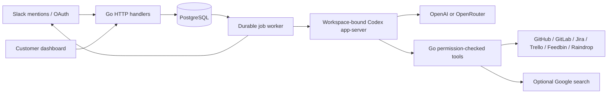

# Architecture and external dependencies

The application source and build/deployment configuration live in this repository.
The Go server embeds its dashboard templates, CSS/assets and later database
schemas. The landing page has a committed copy under `railway/nudgy-tanitim`;
the ignored `sites/` directory is a separate authoring checkout and is not needed
to build the application or the committed landing page.

## What can be self-hosted

| Component | Status |
| --- | --- |
| Go application, dashboard, jobs and integrations | MIT project source in this repository |
| Database | PostgreSQL, run locally or on a provider of your choice |
| AI harness | Codex CLI/app-server, installed at the Dockerfile's pinned version; separate upstream license |
| User identity and messaging | Slack service required by the current product |
| AI inference | OpenAI or OpenRouter service required for AI turns; no local-provider option currently |
| GitHub / GitLab.com / Jira Cloud / Trello / Feedbin / Raindrop | Optional hosted integrations; configure and authorize only what you use |
| Search | Optional Google AI integration |
| Hosting | Any compatible Linux/container environment; Railway is optional |
| Landing page typography | Google Fonts requests; system-font fallback when unavailable |

The application has no separate proprietary backend, license server or closed
plugin package. The hosted services and model weights are not licensed by this
repository. Open-source application code is not a promise of free inference or
full offline operation. Fixed provider origins deliberately prevent arbitrary
URLs from receiving workspace credentials; adding local providers is a separate
design change, including credential routing and protocol tests.

## Authorization boundaries

Slack requests are signature-checked. The server resolves persisted workspace
and user identity; tool arguments cannot supply a different user's authority.
Dashboard sessions are scoped to `/dashboard`, backed by hashed tokens, and
mutations require CSRF/origin checks. Managers choose shared resources, but every
repository/tracker operation also checks the acting user's live provider access.
AI credentials belong to one workspace and are resolved for each invocation.

Code tasks use isolated temporary Git directories and permission-checked file
tools. Nudgy does not execute target repository tests, scripts, hooks or general
shell tools. Finishing a code task publishes a new task branch; a PR/MR and merge
are separate operations. Review [repository tasks](repository-tasks.md) and
[change requests](change-requests.md) before enabling write permissions.

## Stored data and outbound requests

| Data | Storage / destination |
| --- | --- |
| Slack installation bot tokens | PostgreSQL, currently plaintext at application layer |
| Raindrop access/refresh tokens | PostgreSQL, currently plaintext at application layer |
| Feedbin passwords | Encrypted in PostgreSQL with `FEEDBIN_ENCRYPTION_KEY` |
| GitHub/GitLab credentials and stored code workspaces | Encrypted in PostgreSQL with `NUDGY_CODING_ENCRYPTION_KEY` |
| Jira/Trello credentials | Encrypted in PostgreSQL with `NUDGY_TRACKER_ENCRYPTION_KEY` |
| Workspace AI/search keys | Encrypted with `NUDGY_AI_ENCRYPTION_KEY`, or the documented Feedbin-key fallback |
| Conversations, Slack jobs, bookmarks and task state | PostgreSQL; may contain user content |
| Native AI conversation state | Persistent `NUDGY_CODEX_STATE_DIR`; may contain user content |
| Operational analytics | Current writes retain usage/status/tool metadata; legacy records may contain more |
| Model context and tool results | Sent to the workspace-selected AI provider when needed for an AI turn |
| Web-search queries | Sent to Google only when search is configured and used |

This is server-side processing, not end-to-end encryption. Application permission
checks do not prevent an infrastructure administrator from reading the database
or filesystem. Operators must set their own access, backup and retention policy;
there is no universal automatic deletion guarantee. Logs also contain operational
IDs; review and redact them before sharing publicly.
